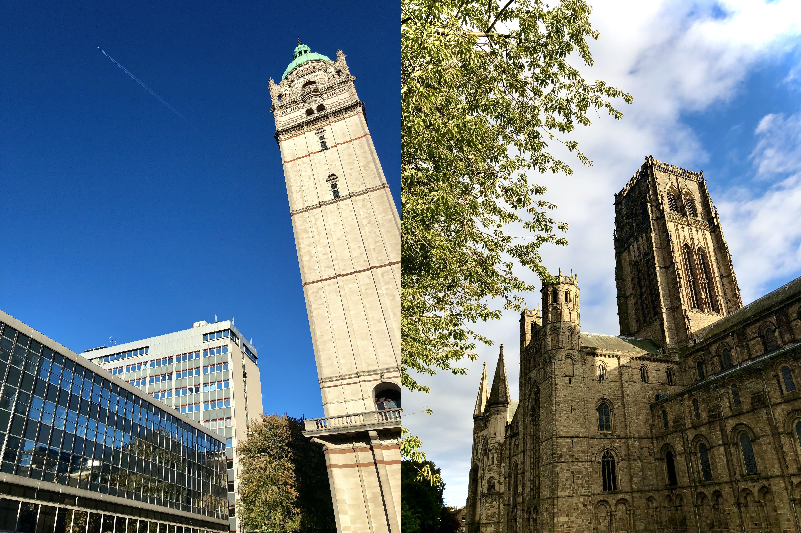

标题（又）是一个梗。

这篇文章的诞生实际上充满了波折，最早的起意是在2019年春天，我想着写点什么作为我在伦敦一年的某种记录和总结，“不列颠札记”这个略带文艺风格的标题也是那时就定下的。然而硕士毕业和博士入学之秋实在是过于忙碌，拖着拖着文章就开了天窗。而后博士和博后几年又是白驹过隙般一晃而过，等回过神来，已经到了不得不动笔的时间，再不动笔下一份工作都要入职了。我尝试写了好几个版本的提纲，然后又推翻再改，一种记流水账的感觉一直挥之不去，始终找不到一个很好的行文思路。最后我决定先把提纲抛在一边，顺着我的思绪直接开始写，写到哪儿算哪儿吧。

注：本文较长（超过两万字），请读者自行把握阅读时间。

#### 一 伦敦

说是不管提纲了，但至少最基础的章节结构还是有的（笑）。

如今站在2026年的时间点往回看，我在伦敦的硕士一年其实像一个完整故事的某个短小前传，和后面七年的乡村生活略有点格格不入。它在往后几年里最大的存在感，可能是开会时和在伦敦工作的合作者们small talk时提一嘴，让他们惊讶一下我在伦敦读过书。除此之外的用处就着实有限了。这大概就是一年硕的含水（？）量。

当然，正经来说，在伦敦一年的经历还是有些事值得提一提的。它是我海外生活的起点，也在不少方面塑造了我往后在英几年的生活习惯。

第一件值得提的大概是Tesco. 作为英国平价超市的代表，Tesco的门店无孔不入，一家express直接开在了我在伦敦住的学生宿舍楼下。这是我第一次见识英国的“高贵”物价，以及重量略微不对就要召唤人工解决的“基本”自助结账机。那时我和许多出国早期的留学生一样，脑内有一个自动乘算的计算器，货架上那些人畜无害的个位数标价进了计算器就改头换面面目可憎了起来，但是饭总归要吃，所以最后还是得两眼一闭刷卡。得益于后来我在杜伦的居住位置附近总是有Tesco，不习惯过多尝试新事物的笔者在之后的八年里的日常采购几乎全部在Tesco完成，忠诚度令人感叹。

笔者也因此见证了它的穷鬼套餐（meal deal）在八年里一路从2.5涨到了3.75. 所以说英国经济我看悬。

笔者在Tesco的第一次采购，最让我印象深刻的是它自营的速食。还没全面感受到白人饭威力，在国内甚至很爱吃培根的笔者对这些当时还只售2.5镑（顺带一提，现在它们卖3.5镑）一份的速食意大利面惊为天人，立刻在Q群盛赞并扬言这一年我光吃这速食就能活。

后续发生了什么读者大概能够猜到，仅仅过了一个半月，我就在同一个Q群发送中超一整个货架方便面的照片并感慨这才是真正的食物。

在这种环境下，我像任何一个（贫穷的）留学生一样厨艺开始突飞猛进，这大概就是第二点值得提的东西了。

俗话说，出国一个留子，回国一个厨子。在人工费比天大的伦敦，如果你不是家里有矿，那自己做饭几乎是节约生活费的必选项。得益于汉口路的膳当家，鼓楼校区的三食堂和金鹰广场地下一楼的麻辣盛宴，我很快主动学习掌握了两道拿手菜：黄焖鸡和麻辣香锅。这两道菜在往后八年里反反复复地出现在我的餐桌上，配方也来来回回迭代了很多次，味道的绝对值已经不差了（而且本来也不是很复杂的菜，否则也不会变成我这个厨房新手的首选），然而我依旧没法找回本科时代吃过的那碗黄焖鸡和香锅的味道。记忆里食物的味道果然是有滤镜的，这也算是一种白月光效应吧。

接下来该说学校了，我来伦敦毕竟是来学习的（正色）。我的学生宿舍的地理位置用中式比方来说的话是二环的外边缘，去学校要坐红线在Notting Hill Gate转黄线到肯辛顿，时长视拥堵情况在四十到五十分钟不等，路上大部分时间没有网络（闭眼），于是我就像意林里说的那样只好提前缓存一些书籍在路上读，且不论方便与否，这段强制断网时间确实算是让我读了不少东西。后来几年再经过伦敦，发现地铁里已经大部分通了信号，环顾左右也是男女老少都盯着手里的一块屏幕滑动社交软件和短视频，不由得有些感慨。

下了地铁到学校还需要走一段大约十分钟的路程，我的上学通勤时间由此拉长到了接近一小时。IC所在的街区是伦敦的富人区，通往学校的路是商业街的同时还塞了两个大博物馆，可能也是这个原因，IC的肯辛顿校区真的很小。各个系楼图书馆食堂放在一起凑成四四方方的一块，外带一块还算大的草坪和Queen Tower. 物理系的楼（Blackett Laboratory）在校区西北角，上课的教室只有三个，全部都没有窗户，而且两个在地下一层。我不确定这算不算肯辛顿地皮金贵的另一个佐证。

课程本身没太多可说的，量不大，内容也不算太难。这倒不是我天赋异禀，而是英国的一年硕最初就是给来买三送一的本科生准备的——三年本科读完，多加一年就是学士变硕士。单独拿硕士出来招生属于是典型的教育产业化创收手段。因此这一年硕的课程列表主要由国内物理系的部分核心课（如数理方法和理力），以及高年级本科的选修课构成（比如qft和gr），我上大部分课属于是二度复炸，自然比第一轮进油锅（？）的同侪们表现自如一些。嗯，水硕的帽子坐实了。另一个值得一提的是，由于专业冷门（不好找工作）的原因，日常课堂上的中国脸孔并不多，某种意义上算赚了，毕竟大家出个国是为了来看老外的，不是来看同胞们的…吧？

唯一算不上水硕的大概是最后三个月的大项目变成了一篇solar physics的文章，工作基本是我完成的，但是在要写文章的时候我正在杜伦忙着安顿，我想着我之后要做数值相对论了，一篇MHD模拟的文章应该用处不大，于是主动把一作让给了IC的supervisor. 如今回头看来，我对publication如此不上心的态度是一个充满讽刺的flag，当然，这是后话了。

这时候就有读者会问了，你在伦敦一年，课程是水的，项目成果白给了导师，那你去是图啥呢？这个问题就问到点子上了，我来伦敦的一个重要目的是申博。

当时的计划是这样的（Listen, here is the plan.mp3）：在英国读硕来给自己背书一下语言能力，同时也想办法在IC弄到一封稍微强些的推荐信，替换掉本科导师那封甚至要我代笔的模板荐信。为此，我盯准天体物理课的老师一顿套瓷——感谢大洋彼岸的诸多高年级本科生和硕士生们和他们在遥远东方的同侪们一样喜欢在课上当后排沉默波比，天天往前坐还回答问题的我很快给老师留下了（正面的）印象。后面我又主动出击找他做小论文，最后成功地拿下了推荐信。

可惜的是，这么一顿折腾好像没有用处，这一年的申请基本是全拒德。由于英国大学普遍贫穷，我能考虑的机会基本只限制在了有CSC合作项目的学校上，一位UCL的老师当时很积极和我沟通了研究计划和申请资料，结果他们系里Dean的钱评审没过。其他几个学校也给了面试，虽然我自认表现还可以，但看上去对方不那么认为。相比之下，反倒是没给我面试的杜伦直接往下顺利推进了流程，CSC和系里很快都过了评审发了offer，让我摆脱了没书读的命运。

此处又有一个伏笔，当时一开始和杜伦的导师聊定的项目是宇宙学模拟，而后四月份某天，他忽然给我发信说有另一个黑洞模拟的项目我有没有兴趣——言下之意就是宇宙学那边有更合适人选了，你看看这个topic你做不做。当时的我正处于被拒信发得头昏脑涨怀疑自己的时候，心想着只要能有物理博读，让我做啥都行，于是飞快地回信答应了。最后我的offer上写的就是这个项目：用数值相对论模拟修改引力下黑洞并合的引力波信号。嗯，听上去非常的物理，很不错！

当然，后面的几年证明我的预想几乎完全不对。不过这又是后话了，让我们留给下几节做话题吧。

笔者在本科时代的回忆文章里记过一笔当年的申请经历。当时我的英语说写真是拉完了，小分全7的要求难如天堑，让我最后和剑桥失之交臂。虽然在那几个月里我以“语言能力不行也是能力不行”的理由自我排解，但我来到伦敦时还是憋着一口失败者的气。在我了解了和我同项目的中国同学们的本科都是什么学校的时候（无意冒犯，但某些同学的毕业学校我听都没听说过），这种感觉更强烈了。如今看来，这种心态其实相当幼稚，但它确实导致了我当时独来独往的行事风格。

哦对了，这种行为是不是如今会被称为嘉豪来着…？

不管这种行为是中二还是成熟，我当时在伦敦的生活在外人看来确实非常乏味。两点一线地来往于公寓和学校，有课时就坐一小时地铁去上课，下课在机房或者图书馆自习；没课和周末就呆在公寓里打电动。一年里没去过任何其他城市，甚至没去过伦敦任何收费的景点。除了想省生活费外，另一个原因是那时的我急于想证明自己。我想证明自己不是来走马观花旅游一年的水硕，证明自己的学术水平值得更好的学校和项目，证明自己和别人不一样。

很可惜，那一年的结局并不算证明了这一点。

完成毕业项目，离开伦敦前，我难得地再次在城里走了走（“再次”一词在这里是实指，我在伦敦一年只逛过两次伦敦，一次是刚到去警局注册后沿着河南岸走了走，第二次就是次年夏天临走前的这一次），伦敦市中心永远游人如织，我就像一个随处可见的普通游客走在路上，对着白金汉宫，大本钟和威斯敏斯特拍照，然后在贝克街的福尔摩斯故居商店采购（made in China的）纪念品。接着我回公寓打包行李，把一堆垃圾留在楼下的回收站里，上飞机回国。硕士时代就这样告一段落。

伦敦一年，我一直想证明我和别的留学生“不一样”。但这种对“不一样”的追求，也许恰恰是我和旁人最大的“一样”。

#### 二 杜伦

2019年9月28日，我再次飞回伦敦，准备北上前往东北英格兰农村开始我的博士生涯。

这段赶路经历本身值得提上一句（很多句），因为CSC非常贴心地包揽了我来回英国的机票，但又非常不贴心地设置了必须是国内航司运营航班的限制（顺带一提，2026年我订回国机票时这个限制已经解除了）。众所周知，会飞去纽卡的中国航司航班并不多。于是在系统里和负责订票的老师扯皮了半天都找不到合适时间落地纽卡的机票后，我干脆改飞了伦敦——我好歹也在伦敦过了一年了，坐个地铁去国王十字转火车的事，没问题…吧？

事实证明话不能说太满，特别是有些事不以你的主观能动性为转移的时候。就比如说你晚上八点多落地伦敦，发现边检居然只开了一个窗口处理一整个大飞机的入境人员。在队伍里苦等并消耗大量手机电量是小事，但坐地铁到火车站后发现最后一班去杜伦的火车已经开走了就是大事了。最体面的做法可能是就近订个宾馆住下，可这是伦敦市中心，当时的我社会经验和钱包都非常羞涩，于是就没考虑订住宿，选择了最直接的解决方案：在火车站体验一回睡长椅的流浪汉生活。

最开始我的计划实际上是在车站厕所找一个隔间坐马桶上睡觉，因为九月底的伦敦的温度已经降了不少，而且夜里阴风阵阵，坐在半开放的车站大厅里并不好受。但是我在厕所里坐了一会儿后，发现自己实在接受不了那种香臭混杂的气味，同时我也担忧后面会有人锁厕所把人赶出去，于是最后还是灰溜溜地回到了外面的长椅上。但这还不算完，因为国王十字晚上会关门。车站最后一班车发出没多久，大概凌晨一点多的时候，工作人员来把我和旁边几位看上去也要熬夜的倒霉蛋赶去了街对面的圣潘克拉斯车站。当然，从睡眠环境（？）来看两个车站没什么区别，都是长椅，都是只能趴在行李箱上的姿势睡。这样的条件对于我这种睡眠质量不高的人来说自然是没法睡着的，我半梦半醒地挨了几个小时，又进了一家咖啡店开电脑想打会儿游戏（eu4，快速消耗时间的神），结果没找到免费的插座，只好作了罢。刷了会儿网页，不好意思不花钱在人家店里坐着，又跑到外面长椅上趴着（试图）睡觉，最后也没睡成。

就这样折腾了一夜，熬到第二天早上八点多，我坐上第一班北上的火车前往杜伦。在那班火车上我体验到了记忆里极其少见的状态：我自己不想睡，但实在是困得不行，稍微不注意就要不自觉地睡过去。如今回想起来，已经不记得当时在车上是不是真的睡过一阵子了。

但至少我没坐过站（笑）。29号上午11点半，我到达位于纽卡斯尔南边的小城杜伦。这是我往后度过七年人生的地方。

杜伦是个小地方。这一点应该没有人会反对，整个town的常住人口只有八万左右。但它的知名度倒是尚可，原因其一是那座建在威尔河湾高丘上的大教堂，它是哈利波特（影版）的取景地之一，算得上是一个tourist attraction，我还很快在上学路上的小教堂背后找到了一个视角很好但人流量却很少的大教堂观景点，拍了不少后来成为我工作电脑壁纸的照片。知名度的原因其二自然就是杜伦大学了。列起名号来，杜伦大学确实有几个还算拿得出手的头衔，比如英国第三古老的大学，最受英国中产阶级欢迎（？）的大学，在各个英国本地排名里也长年列在前五，不过大家最关注的那个排名里，杜伦一直不温不火地呆在前百守门员的位置上浮浮沉沉，很让人感叹名号可能还是抵不上充钱来得有用。

笔者博士四年住在Claypath的Student Castle，这以我微薄的CSC生活费来看是个非常奢侈的选择，但它的各项硬件也确实无可挑剔。隔壁就是镇中心的商业区（对于我而言最重要的是靠近一家Tesco），离学校也很近，便利的地理位置对国外公共交通极不信任的我而言堪称一站式解决方案，而且一周180镑出头的studio也不算太贵。作为对比，我在伦敦二环住的破studio要价高达250镑出头。

后来我才知道这个价是Student Castle的开业优惠。我住了四年，见证了它的价格一路从180涨到了230，所以说英国经济我看悬（重申）。

杜伦做天文的人基本集中在主校区西南角的一幢设计新潮的建筑里，叫Ogden Center West. OCW一共三层，大致按不同研究所分层，每层几十个办公室和会议室环抱着一些社交区域。我归属于计算宇宙学中心，因此办公室在三楼。按惯例，博士一般好几个人分一个办公室，我分配到的办公室一共五个工位，不过我作为刚到的新生只能挑剩下的比较靠门的位置。好消息是这个位置每天进出办公室跑路方便，坏消息是办公室的门正对着老板办公室（闭眼），往后半年里每次下班都得看一眼老板走了没有。系里每天上午和下午在社交区域都有coffee break，中午则是一堆人坐成一圈吃午饭，可以想象这种事情对于i人加英语羸弱的笔者不亚于酷刑，因此在参加并如坐针毡了几次之后，我开始窝在办公室不再出门，中饭则去行政楼附属餐厅吃或者打包回来在工位上解决——后来我的午饭逐渐退化成了极其简单的饼干或者巧克力，再后来干脆不吃了。

由于杜伦大学的存在，杜伦的中国人很多，属于在学校里随意点五个路人里两个是中国学生的程度。但由于天体物理不是热门的留学专业，博士也不是热门的留学目标学位，因此系里的中国人并不算多——当然，也算不上少。作为对比，等我到了计算机学院那边做博后之后，组里则是一个中国人都见不到了。在杜伦的几年里我依旧是那个自闭不会主动社交的人，因此在此处我要感谢几位名字不一一列出的主动向我打招呼的同学和学长。受益于他们，比起在伦敦，杜伦时期我的社交圈（至少在同胞方面）相对而言正常了不少。

除了中国人外，我也算认识了几位外国同事，比如坐我隔壁的西班牙小哥Victor，作为和我同级的博士新生他显然要外向得多，甚至会邀请我一起打LOL和EU4，还有同一办公室的博三学长Aidan，虽然他的本地东北英格兰口音让我理解起来有些困难，但在我刚到时也帮了很多的忙。可惜的是，后来因为疫情lockdown的缘故，我们就此断了联系，等到博三再次回归线下办公，我们的办公室也已经重新排组，平日里也不常见到了。新办公室里除了同胞外，一位泰国学生Suttikoon和我比较熟悉，有我们来自同一文化圈的缘故，大概也有他本身性格外向喜欢交朋友的缘故（后者大概比重更大）。后来我早他一年毕业，跑去了计算机学院做博后，等到我再度回到OCW时，他也已经毕业回了泰国。在此祝愿他一切顺利。

老板Baojiu Li是一位中国人，我入学的那几年正好赶上他评上教授。我对他的初印象其实偏向严肃，但后来才意识到并非如此，他实际上是一个挺幽默的人，尤其是在用英语的时候（后来我发现我自己也有这种用英语更会开玩笑的偏向，合理怀疑是被各路洋人的small talk影响的结果）。入学后我和他讨论了课题开展的计划，按Baojiu的预想，这个项目会基于ExaHyPE1引擎“已有的”（记下这个flag，后面要考）数值相对论代码进行modified gravity的修改。而之所以选择这个特定的数值相对论代码，是因为ExaHyPE1的原作者Tobias Weinzierl（但他并不是那个数值相对论代码的原作者，记下这个伏笔，后面也要考）如今恰好是隔壁计算机学院的教授，正好可以来做我的co-supervisor. Tobias是一位相当热情健谈的德国人，第一次见面就给我留下了非常能聊的印象。他向我介绍ExaHyPE的具体内容我已经记不清了，只记得他说有二十来个人使用这个代码的时候有些意外——我原以为人会更多一些。但我当时也没有特别在意，如今看来，这又是一个flag。

接下来几个月是我学数值相对论理论的时间，乏善可陈，按下不表。次年春天，我开始尝试在超算上跑这个ExaHyPE1上的数值相对论代码。一场持续两年多的折磨就此拉开序幕。

#### 三 PHD=Pandemic, Heartbreaking and Disoriented

上文之所以说这是一个已有的数值相对论代码，是因为意大利的一个合作组在18年完成了这个代码发了文章，声称它给出了良好的模拟结果。上文之所以说这是一个“已有的”数值相对论代码，是因为我接下来花了几个月时间都没有成功复现他们的结果。当然没法复现在跑模拟的科研里也不算什么新鲜事（？），现代复杂代码库里的自变量实在太多了，因此如果不能完整复刻当时的代码库以及运行参数和环境的话，遇上毛病也属正常。很自然地，既然工作来自一个合作组，用的引擎还是我老板写的ExaHyPE1，想必拿到当时的代码库也是一封邮件的事……

什么叫没人知道当时用的是哪个版本的代码？什么叫文章作者回邮件回着回着不说话了？

两位意大利的合作者一开始相当客气地回了几次邮件，同时也有杜伦另一位之前负责维护这个数值相对论代码的同事提供了帮助，但很遗憾的是效果始终甚微，该跑不出来结果的依旧跑不出来结果。我尝试修了几个月bug，无功而返，再往意大利发邮件去，便已经石沉大海了，我记得我当时气得连质疑他们学术不端编造结果的心都有了。后来我和两位老板合计了一下，觉得既然这个旧代码和原作者们已经指望不上了，那么再修下去也是沉没成本，正巧Tobias正在基于新架构重构ExaHyPE到第二代引擎，我们来把ExaHyPE1上的数值相对论代码移植到新的、更容易得到本地活跃技术支持（指老板）而不是远程邮件帮助（指意大利人）的base上岂不是一举两得？现在引擎是现成的，原来的legacy code也是现成的，移植一下换个API接口的事，三个月应该就完成了……

什么叫ExaHyPE2还是半施工状态？什么叫求解器也要自己写？什么叫所有feature需要我重新加一遍？

值得指出的是，这件工作放在2026年的如今来看算不上什么，重构移植feature，在数值方案明确的情况下写求解器都是LLM的标准优势区间——Token能解决的事能叫事儿吗？然而在前AI时代的2020年，要一个物理背景的博士生在一个还在开发中（=随机掉落新bug）的引擎上写出一个完整的代码库就是另一个故事了。我从2020年开始写，从物理kernel和初始条件写到API和求解器，中途反复被各种新老bug折磨，一直写到2023年才勉强把双黑洞并合跑通。这个ExaHyPE2上的数值相对论代码在我博后期间进一步开发，发布时被命名为ExaGRyPE（命名法来自于ExaHyPE+GR，实际上并不是一个真正全长名字的特殊缩写，另外以防有读者真的对这代码有兴趣，这是[ExaGRyPE的发布文章](https://www.sciencedirect.com/science/article/pii/S0010465524003588)），它可以说是我七年来几乎全部的工作成果。

这个听上去还不错的结局的代价是我的实际论文产出惨不忍睹。按如今的学术界标准，我在博士期间的发表数量说明我四年里一大半时间躺在床上睡觉。没有人会在意你发不出论文的工作是否基础或者是否重要——至少我回国后聊的高校领导们无人在意。我的学术训练也几乎被完全搁置，学位是拿到了，但工作内容几乎没有新物理，我也不知道如何去找新物理，更别说完成从问题到论文产出的转化了。两本带去的cosmology和galaxy astrophysics也吃了灰，基本没再翻开过。博士的前期我听不懂系里的报告，我自我安慰说是因为我还刚入行；但到了博三博四、博士后的时候，我依旧听不懂报告，这就没理由可找了。当然，严格来说我要是硬要找借口还是可以找到的，但最重要的是我没法回答心底逐渐浮现的疑问：我到底是来读物理博士的，还是来当research software engineer的？为什么我一天到晚在做程序开发和debug，物理呢？

当然这还不算完，另一个代价是我的心理状态。无尽的bug和没有头绪的开发方向逐渐消磨了我的科研自信和热情。为什么我修不好这个代码？我还能顺利毕业吗？我开始熬夜，失眠，精神一落千丈，上班呆坐刷手机，看到超算上crash的job就头晕目眩，最恶劣的时候数次想过退学。我查CSC的退学政策，想怎么和家里人开口，想象我退学了之后要干什么，能干什么。

最后我还是没有真的这么跑路，咬咬牙坚持了下来。我并不想美化我当时的这个决定：客观上来说，我没有退学更多的是某种惰性和害怕使然。在那个时间段，放弃比坚持无疑需要更多的勇气。当然，也许有一部分小的原因是我依旧保有做学术的理想（更具体的心路历程，我们留到后文再谈）。我就这么挨着挨着，挨到了22年中，事情终于有了转机。当时我就mental health的事项和Baojiu谈了谈，得到了一些项目规划调整和鼓励评价；另一方面经过一年半多的死磕，代码状态终于开始转好，不再是走几步就要crash一次的草台破船了。因而我得以在相对正常的精神状态下完成了博士最后一年。

现在回头来看，我状态最糟糕的博二博三两年恰逢疫情，我被一周七天关在自己的studio里，只有周日出门一小时采购。我毫无疑问是一个很宅的人，因此当时的我并没有感觉到什么生活封闭带来的心理不适。但被关在家里确实也隔绝了我和老板以及其他合作者small talk的渠道，让我失去了很多从他人视角审视自己工作的机会，也失去了很多在自然情况下和老板开口聊项目进度和忧虑的机会（一个许多人应该都有同感的事情是，线上会议的参与者发言会更谨慎和严肃，small talk的意愿和频率都会下降。在疫情结束后我的组会改成了线上线下交替的形式，这一点对比变得更明显了）。那两年我的诸多症状非常接近习得性无助，而缺乏外界的客观评价可能是一个重要原因——没有外界的锚点，很多情绪是自我正反馈增强的。从这个角度看，疫情确实在我没有直接感受的情况下，间接地给我留下了巨大的负面影响。

我的博士（和博后几年）几乎完全花在了ExaGRyPE的代码基础建设上。如果没有疫情，或者我拿到的项目没这么半成品，我的学术道路会顺利一些，精神状态会好一些吗？如今我们已经不得而知。

唯一可以知道的是，2025年Anthropic发布了Claude Code, OpenAI也重新推出了Codex, AI coding的时代拉开了序幕，很多过去我遇到的困难也不再是困难——可惜的是，那时我的科研生涯已然接近尾声。

#### 四 生活和毕业

老大，我们第三节是不是太消极了喵？

……确实，我们来说点没那么苦的事儿吧。

Student Castle的住宿条件确实不错，该有的家具家电一应俱全，更何况我是第一年的住客，享受的是全新一手房（？）。studio本身也不小，因此虽然我一周167个小时被关在房间里，物质生活方面也没有感受到特别的不便，这算是一个小小的幸运之处。同时由于我住在一楼，我还发现了旁边的野草堆里常有两只野猫路过。人类因为疫情被关在屋子里，反倒让这些流浪猫变得自由了起来。我一开始用自己吃的鸡腿肉和香肠喂它们，后来发现这成本有些高，于是特地去买了猫粮，还自制了能把纸盒从半封闭的窗口伸出去放在地上再收回来的杆子来重复利用猫粮盆。其中一只野猫是狸花，相当亲人，喂了几次之后，很快就能从窗户里伸出手去摸它的头（猫不错，给我摸一下.jpg）。另一只则是奶牛猫，这位相对而言就比较白眼狼了，我喂了少说有几个月了，但它还是我一有动作就跑。中途几周我还特地把猫粮放在窗台更高处，试图训练它接近和熟悉我，但效果甚微——虽然它会上窗台吃饭，但我隔着玻璃一动它就会紧张地盯着我并视情况跑路。更糟的是这只奶牛猫的战力大概大于那只狸花猫，因此后来的时间里我几乎没再见到那只狸花，窗台前只剩下白眼狼奶牛猫在大快朵颐。久而久之我也没了耐心，等一袋猫粮喂完，我就没再继续买，哪怕它来窗口下面蹲着我也不再理会了。

后来某天我看它在窗前蹲了一会就朝另一边走去，我从窗子里伸出头转过去看，才发现隔壁房间里也往外放了猫粮，敢情这是它的美食一条街。这下它的白眼狼行为有了个合理的解释。我不再喂它之后，渐渐地它就不再出现在我的窗前，等到我后来从Student Castle搬走，反倒时不时想起那两只野猫，不知它们如今过得如何。

（豪华）学生公寓的另一个好处是它配备了设施齐全的健身房。虽然我之前没有跑健身房的习惯，但免费的服务用了就是赚到，于是我时不时就去一趟，待上一个小时cos运动达人。除了健身房外，我又有了高中和本科时代户外跑的习惯。在伦敦读硕时这个习惯因为不熟悉周围车水马龙的路况被暂时放下了，到了杜伦之后正好重新捡起来。威尔河沿岸有几条不错的沿河步道，路上风景和空气都极佳，而且也有几个分岔口方便根据身体情况选择长短不同的路线，因此疫情缓和，大家得以从家里放出来后，我就常常出门跑步。可惜博士后半段和做博士后期间工作渐忙，我又开始变得懒惰，锻炼也逐渐变成了卧室体操类，户外跑的习惯没能一直坚持到最后，实在有些可惜。希望如今回国工作了能找到重新开始的机会吧。

日子就这样一天天地过。如前一节所言，虽然博士中间一段时间真的过得很艰难，但最后我还是坚持了下来，比较顺利地毕了业。毕业论文写了大概三个月，分了三块，第一块是ExaHyPE2引擎本身开发（由此可以看出我花了多少时间在基础数值软件开发上），第二块是ExaGRyPE的代码开发（最后也只到双黑洞并合，很遗憾地没有新物理），第三块是博三中间为了填上发表空白做的一个side project（作为对比，这个side project只做了半年就出了一篇文章，而ExaGRyPE吭哧吭哧了七年才憋出来一篇，对比令人咋舌）。写毕业论文的时候，ExaGRyPE的文章还没发表，因此两百多页的带附录的thesis里超过四分之三都是未发表内容。

博士答辩是23年九月份的事，一个external examiner，一个internal examiner，为公平起见，主要由external examiner主持。英国的答辩（viva）不包含presentation的环节，而是直接从thesis第一页翻起一个个问题问下去，检查你是不是~~真的是这个领域的专家~~独立完成了全部工作，拥有了相应的知识水平。我的external examiner是英国另一个数值相对论组GRChombo的前辈Eugene Lim, 一位非常健谈积极的韩裔（我并不知道他是否入了籍，所以严谨起见以此词描述），答辩的时候问题问得很仔细，但态度相当友善。后来我才知道他是GRChombo的原作者之一，当年最初的代码框架也是由他一个人完成的。不知他有没有在我身上看到了几分自己的影子。Internal examiner是隔壁部门CEA的教授Chris Done，她也是我博士中期答辩的examiner之一。

答辩是下午两点，被直接安排在了Chris Done的办公室里，出席者只有两位examiner和我。这实际上略微出乎我的意料，因为我曾经在南大时旁听过一些博士答辩（？你旁听这干啥），当时它们的规模要大很多。现在回头考虑一下这也合理，因为英国viva没有presentation，所以也只有提前看过毕业论文的examiner能有效参与到讨论里，而我的两位老板基于导师回避的原则也不能在场。答辩总计花了三个小时，上半场一个半小时，主要过了side project和一部分基础代码架构。中场休息惯常有个coffee break，我则因为英语模块有些过载直接找了个借口去了外面透气。回来后继续问完基础架构和ExaGRyPE. 问题问得很深入，但大多都不难回答，笔者的四年时间好歹没有白费。中途有个问题提到了我没有考虑过的角度，我跟着第一反应给的回答是错误的——此处略去了一些（对本文）不重要的技术细节——但Eugene指出错误后很快给了解释，我们甚至就着这条往下讨论了一会儿未来可能的代码解决方案。

大体来说整场答辩的气氛还挺轻松，问题也大多是建设性而非质疑性的，不过我作为被审查的那个精神始终有些紧张，每次抬头看钟才意识到时间已经过了好一阵。这种紧张持续到了答辩结束，examiner按学术惯例打发我出去等结果的时候。理论上说examiner需要在答辩人不在场的情况下决定我是否通过，但当时根据答辩的进行情况，我基本已经确定了我会通过。事实也确实如此，等我再回到办公室的时候，Eugene已经在祝贺我成了Doctor了。随后他便乐呵呵地跑去三楼找Baojiu，说是要叫上我的两个老板去pub喝一杯。

等会儿，我也要去吗（手指自己）？

总之，似乎按惯例，通过答辩的博士在这种场合也是要出席的，但作为一个i人，和一群人去pub（其中还包含三位老师）更像是一种上刑而非庆祝。如果换在平时我大概会老实地参加并面带礼貌微笑地坐在一边听老板们谈笑风生，但我急于回去自己按自己的方式庆祝拿到学位，所以当机立断直接招呼都不打就跑路回了家。这么做并非是我不礼貌，而是笔者对自己的脸皮薄度很有自知之明——我告别，他们挽留，他们挽留，我不好意思，我不好意思，我就只能跟着去pub了。

通过答辩，拿到学位的那一天毫无疑问是我几年以来最快乐的一天。在我如今情感逐渐钝化的历程里，那天的心情依旧给我留下了极为深刻的印象。两位examiner祝贺我的时候，我忍不住坦白说过去有两年我好几次觉得自己拿不到这个学位了，他们感到相当诧异，但这确实是我最低谷期的真实想法。我曾经痛苦过，挣扎过，想着自己没有任何成果的工作，想着真的退学了自己该往何处去，但我终归是坚持了下来，无论是惰性也好，是害怕也好，我坚持了下来。如今我拿到了这个博士学位，过去日日夜夜的痛苦，总算有了些许报偿。我还记得当时我跑路之前先在系里一楼上了个厕所，然后面对空无一人的大厅，字面意义地高兴地跳了起来。

前有 我做到了！所以 干得好！

#### 五 博士后

收拾完心情，把Minor Amendments的论文改完，被正式授予博士学位，证书寄回中国。我正式告别了自己的学生时代，进入了工作阶段……吗？

严格来说是的，但又不完全是。这里值得把时钟往回倒转大半年来提两句背景。

第一节有提过笔者的博士受的是CSC资助，因此毕业后（理论上）需要及时回国，唯一例外是可以申请继续做博后，且至少能做两年。博三之前我没考虑过这些问题，毕竟当时我连自己能否按时毕业都不确定。而到了博四的秋天项目代码逐渐好转了之后，Baojiu和Tobias在组会上提到了希望我留在杜伦继续做博后的想法，理由是ExaGRyPE项目还没有完成（如上文所述，23年的时间点上ExaGRyPE的文章尚未发表，更准确地说是有bug还没修好）。正好我也没考虑好去哪儿做博后，干脆接受了这份邀请。

我的博士后由两部分组成，前一年半在计算机学院，后一年半在物理学院，因为两个老板哪边都没有足够的钱。英国经济我看悬（重重申）。虽说前一半是cs的博后，但发钱的是Tobias，做的还是原来的项目，ExaGRyPE的组会照常是我主持，工作内容也几乎没有任何变化。因此在工作方面，除了我要参加Tobias组的大组会外，我对自己已经不再是学生了这件事是没有多少实感的。具体的变化反倒出现在要从学生宿舍搬走的这件事上。

Student Castle这种（豪华）学生公寓作为英国教育产业化的优秀代表之一，自然是设施崭新，服务周到，相比之下新住处就没这条件了。我和同部门同事合租了一幢典型的英国联排两层小house，和其他长得几乎一模一样的小house一起挤在主马路叉出来的一条街道上，据中介说是二战过后没多久建的。house的地理位置在镇子东北，需要从市中心逆着往学校方向再走上二十分钟，中间还有一个雷霆大斜坡要爬。同时因为我名义上去了计算机学院做博后，因此办公室也从OCW里搬出来往南，逆着往家里方向再走十分钟，中间又有一个雷霆大斜坡要爬。我的步行通勤时间因此从二十分钟直接乘了二点五倍，我走了几次很快就放弃了。选择坐公交的话则是要在市中心转车，而市中心的车站来车时间飘忽不定，准一阵晚一阵，严重打击了我去系里上班的积极（存疑）性。疫情结束后大多数会议转成了hybrid的形式，老板也对我的出勤不做要求（Tobias自己也一周只来两趟学校，Baojiu更是时不时往国内跑），因此搬家后没过多久我便过上了大部分时间work from home的生活。

Tobias自己的组里没有中国人，大多数人做的是高性能计算和编译器类的方向，笔者加入到他的大组会之后常常插不上话。偶尔去办公室，坐着的大多也是纯计算机方向的博士/博后，再加上我是个不喜社交的人，因此许多人到最后离开时也不过是点头之交。本想着当博后了可以上一门计算机系的基础程序或者数学课，结果邮件去问时才得知因为入职太晚，习题课之类的位置已经分配完了，给我落了个（不是很想要的）清闲。我博士后的工作唯一能和博士期间做出区别的大概就是带了两个研究生项目，项目是我和Tobias想的，挂在他名下，但实际指导工作由我完成。其中第一位（称为T同学）项目表现很好，Tobias和我评价都很高，后来老板想办法拿到了一笔钱，让他留下来继续读博士，T同学这几年在ExaHyPE的基础功能性方面做了相当大的贡献，整体而言算是个相当成功的研究生项目。另一个项目的学生（称为L同学）表现就略逊一筹了，虽然起步时物理方面的理论学得不错，但代码写得很慢，而且到最后也没有能够算得上是交付的成果，被Tobias打了个低分。后面这位L同学还向我们要了推荐信，这一点本身倒是很平常的一件事，但他很不靠谱地只在DDL前给我留了两天，害得我反复检查我的收件箱确认是不是之前错过了他的提醒邮件。DDL那两天我还正好在曼彻斯特开会，花了晚上休息时间给他写完信提交，和Tobias一聊才发现他那边情况也是一样。可以预想，就他的项目表现和我们俩只能算weak support的referee，最后他申请结果大概不会太好——不过这就不是我需要操心的了。

就这样过了一年半，ExaGRyPE终于修完了最后一批bug，文章也顺利发表了。我也在25年春结束了在计算机学院的短暂旅程，拿着Baojiu的钱再次迁徙回了物理学院。除了办公室从五人间升级成了三人间之外，工作内容依旧是老样子。OCW也和读博时相比没什么变化，可惜的是曾经熟悉的脸孔大多都已毕了业，新来的学生和同胞们也基本不认识，而我也因为临近在杜伦的最后一年，变得进一步回避社交了起来。Baojiu虽然时常撺掇我来系里露面，但由于我的新办公室在二楼，平日里和办公室在三楼的他也碰不上几次（另外一提，Baojiu自己和我一样也不喜欢参加coffee break，我几乎没在社交区域见到过他）。

博士后的最后一年半可谓乏善可陈，唯一能提一句的可能是我终于在杜伦的最后一年被发配去上了一门习题课。这门叫foundation of modern physics的课程内容大致等同于国内的普通物理一，是物理系和其他理工科专业大一的必修课。这门课的习题课部分被切成了数十个小组小班化教学，足以体现杜伦对本科教育的重视，但这些小组大多要分配给没啥上课经验的博士后甚至博士带，又让这个重视的说法有些微妙。我的课时被安排在每周一的五到六点，上课地点是OCW隔壁物理系主楼里的一个学生实验室，冬天期间到了上课时间外面天已经完全黑了，让人想起当年本科时每周三晚上夜课做物理实验的时光。

习题课内容是给若干名大一学生复习每周知识点和讲题。之所以说是若干名，是因为即使有签到系统卡着也有学生会间歇性地不来。尤其是假期前后的几次，最惨淡的时候理论上的六位同学只到了两位，正好还赶上教学督导在后排旁听的那次（闭眼）。课程内容非常常规，按普物的风格力热光电各讲一些，再配一点电路，狭相和量子物理入门，正好卡在我（看了答案之后）不需要复习就能讲明白的水平线上。第一堂课前我非常紧张，想着当时分配习题课的负责教授在induction上强调了多次要和学生互动，提前三个钟头在没人的办公室把每道题的过程自己讲了一遍，认真程度约等于博一博二时代准备组会。过往的经验告诉我这种紧张度下即使准备完全，开口第一句话也一定会卡住——事实上也确实卡住了。好在我的脸皮在长年“没进展也要汇报”的组会上有些许进步，强行装作没事人一样讲了下去，讲满了一节课。

笔者的习题课学生里没有中国学生（有一个被调来又很快被调走了），但我很快发现有些事确实是天涯若比邻地跨大洲一致，比如老师一提问下面的学生就一齐低头避免眼神接触生怕被点到。这个现象随着课程推进越来越严重，开始几节还有零星学生会回答问题，等到了第二学期我大部分时间只能自问自答。事实证明我咨询的博士后传授的经验没错，我只管自己讲自己的，题目讲完就提前下课走人，对学生和自己都好。当然，这也意味着我要一个人嘴不停地填满一个小时，而且很多时候是在不做多少准备的情况下——习题课每周一次，这个频率下要我像准备talk一样提前一天甚至两天就开始练习很不现实。这一点让我每个周一傍晚都像上刑，但也得益于此，我的英语口语水平由此突飞猛进，进步之大大概抵得上过去七年的总和。虽然开口语法错误依旧遍地都是，词汇量也不见有多大的增加，但我习得了“无论之前发生了什么都可以继续说下去”的听上去非常唬人的能力。这个能力除了大幅提升了（自我感觉的）口语流利度外，最重要的是降低了英语模块在我大脑里占用内存的比例。从此以后无论是small talk还是组会，我明显感受到我能更自然地在说英语的状态下思考了。可惜的是，这个能力提升直到我博士后的最后一年才到来。

#### 六 求职与离去

博士后期间我的产出依旧惨淡，虽然ExaGRyPE本身的曝光度尚可。文章发表之后被CPC邀请做了个线上的keynote报告。国内国际会议跑了几个，在英国的数值相对论社群里也混了个脸熟，代码忝列于Einstein Toolkit和GRChombo之间。但除了ExaGRyPE的发布外，我再没有新的文章写出来。两个老板就此提了不少次，但如我前文所言，我的博士时代过于专注于造轮子，严重缺乏对open question的挖掘训练，因此在ExaGRyPE发布之后，我空有代码却不知道要做什么，干脆自然地投入了新的（广相流体）模块开发之中，结果又是bug层出不穷。来回修复加更改方案，不知不觉就到了2026年。

这时候也许就有读者会问了，既然都已经这个时间点了，为什么不使用神奇的AI帮忙呢？这里最大的问题是时间上有所错位。截至2025年初，agent coding还不完善，ExaGRyPE好歹也是10K+行的大项目，指望用原始形态的软件或者干脆给chat窗口发一堆文件加prompt描述来解决工程问题实在是不大现实。而等到Claude Code和Codex横空出世并迅猛地占据各个编程生态位的时候，我的博士后已经进入最后一年。而当时我已经没有了全面改进代码的动力——我做下了离开学术界的重大决定。 

这个决定本身是下一节的话题，此处先行跳过。由于CSC政策的限制以及我个人的各方面考虑，我计划当（如今已经不怎么吃香的）海龟回国工作。因此我从今年一月开始找国内的岗位，试探性地在招聘网站上挂了自己的资料后，时不时就有中介来联系我推荐人才引进的项目。中介刚开始和我联系时我相当受宠若惊，毕竟他们不仅包办岗位匹配，又画了高待遇的大饼，让我产生了自己非常吃香的错觉——随后我发现这确实是错觉，大半中介了解到我的专业之后便哑了火，微信消息回得越来越慢，问就是还在匹配公司，推荐来的企业也大多牛头不对马嘴。有的中介甚至暗示不需要考虑匹配度，找个有资格的企业把补助拿到手最重要。我也自己试过主动出击投简历，但我的背景转工业界确实需要一些包装和话术，而这一点超出了我的知识水平范围。企业招个博士，肯定是期望找到能立刻上工的人，要别人付费培训你是不现实的，因此我投的简历大多石沉大海。偶有几个真企业HR主动来联系我的，也大多折在先期微信电话沟通上，少有能进入面试阶段的。最终我拿到的几个面试都是中介拉来的机会，多亏我在英国多混了三年博士后符合了人才引进条件，否则这工作找起来怕是要麻烦上不知道多少倍。

面试的单位不宜在这里仔细介绍，总体来说国央企居多，出于个人因素，我主要只看了在长三角地区的机会，于是可以猜到的是他们大部分都在上海。由于我身在英国，所有面试都在线上完成。面试的单位里有态度很好、流程也很正式的；也有态度平淡，走个过场的；当然，也有不尊重人，甚至问莫名其妙问题的（什么叫“黑洞真实存在吗？”）。面试过程一般从我讲slide开始：把过去码了七年的代码包装一下吹嘘一番（“你能再表演一下那个吗”“面向复杂非线性物理系统的大规模软件工程实践”“我就爱他说这个绕口令”），然后放一些不知道是不是有用的成果图片，试图证明自己工作的重要性。讲完就轮到出席面试的诸位面试官们提问，这个阶段可以明显感受到有些面试官的专业和我重合，问出来的问题都很切中要害；有些专业只是擦个边，主要提行业内的通用问题，但至少还在技术范畴内；还有的则是完全牛头不对马嘴提一些不尊重人的抽象问题，比起来面试更像是来消遣人的（自然我没拿到这一家的offer，但说实话面试给我这个待遇，有offer我也不会去就是了）。

面试断断续续从三月持续到五月中旬，offer拿得不多，但质量都还过得去。最终决赛圈里剩下两家上海国企。西边那家是传统国企大院，园区配套很好，因此本来是我的第一选择，但随后得知其加班问题有些严重，尤其是大院模式让平常call人加班更容易了，遂决定转头入职东边部门更年轻的那家。那家相比之下面试和HR沟通下来让我感觉更自如一些，别的待遇方面也落实得更到位。因此这个最终决定也不算太过艰难。

到了这个时间点，在杜伦的事情也到了收尾阶段。最重要的自然是“安排后事”：ExaGRyPE的交接工作。

一个有些可惜的事实是，我在杜伦的前几年里没有新的PhD学生和博后加入ExaGRyPE项目组，我像半个孤儿一样单打独斗了好久。不过这也怪不了老板，毕竟当时这个项目前景一片黑暗，再往里投入学生名额和钱实在是有些划不来。我博士毕业后，项目情况变好，老板发出去的position也成功招揽来了一位同样拿着CSC资助机会的PhD候选人，预期2025年入学。这一切本都卡得刚刚好，还给我和新人留了一年时间适应工作和交接代码，结果英国签证局发了狂，新学生的赴英学习的签证检查（即ATAS）死活不过。申请一次被拒，改了项目描述再申又被拒，等几个月再审还被拒。由于ATAS的审核过程是完全的黑箱，因此没人知道这个纯理论模拟的项目是哪一点触动到了这些行政老爷的神经，新生和我们只能像没头苍蝇一样凭推测改文书，玄学程度堪比申请美国签证和在A社手下保护自己的claude账号。

就这样拒了改，改了申，申了拒的循环重复了好几次，反反复复折腾了一整年，直到新生和我连同组里两位老板都没了脾气，最后只好联系CSC改派去了德国。中途等ATAS的一年他还非常积极地远程参加组会和部分工作，让我们有些惭愧，好在这些工作作为一种预训练也在他申请德国position的过程中发挥了一定的作用，不算完全付诸东流。在此也祝他未来一切顺利。

组里没能来一位新PhD学生确实有些可惜，但好消息是ExaGRyPE（和我）最后也算找到了接班人。一位今年从国内来访问的博四学生恰好有做NR的兴趣，并且也有来杜伦做博后的意愿。而且和我不同，他是带着物理问题来的，虽然他代码方面的训练略弱，但如今有了agent coding，单纯的代码能力很容易补足。在和老板们确认组里有续聘一个博士后的经费后，事情就这样成了。

和国内的HR确定完offer，准备完人才项目的资料，我在英国的日子也进入了两位数倒计时。杜伦的最后三个月里我的生活其实还挺轻松，每周的组会照例是笔者主持，但我逐渐转型成了PI的角色负责跟进各个项目的进展，同时指导学生和external RSE进行开发工作，自己不再经手实际代码开发。最后一段工作里，我写邮件和文档的时间远超写代码的时间，状态与前几年可谓天差地别。

而后就是搬家了。我房间里有两个纸箱，是当年在伦敦为了寄行李从快递公司买下的，它们随我从伦敦到了杜伦，又从学生公寓搬到最后住的小house里，当了好几年的床头柜，如今它们重见天日又变回了行李纸箱。由于我断舍离得非常坚决，旧衣服、生活和床上用品大部分都进了回收站和垃圾桶，整理出来能卖的东西都二手卖了，因此最后回国的纸箱甚至只装满了一个，比我当年从伦敦寄来杜伦的行李还少。

最后一周的组会上我主持完汇报流程，接着感谢了出席的老板、合作者和学生，如今我说这些已经不需要提前准备了（感谢习题课的训练）。随后我与Baojiu和Tobias各自见了面告别，感谢他们七年的指导和帮助，又找时间和继任者聊了几句，交代了后续博士后以及德国合作者的事，算是正式地给我七年的杜伦科研工作收了尾。

我的机票订在合同结束往后几日。中间除了和认识的同事告别，清理房间给下任租客，在小红书上卖二手外，我又特地抽了些时间在杜伦城里走了走。

我不是一个爱在外面跑的人，在杜伦七年，也不好说自己多熟悉杜伦。大教堂我只在博士入学参加典礼时去过一次，南边那些学校附近的“网红”观景点停留在别人出的片里，市中心许多饱受好评的店我也没走进去逛过，如今也已经来不及再去了。这里面有我（可能）最有新鲜劲儿的几年被疫情关起来的原因，也有我自己过于轻慢的原因：总想着博士的日子有那么长，博士后的日子有那么长，这些地方后面总有机会来逛的。离去之时才意识到，来日方长只不过是一张空头支票。我行前走过的路线因此集中在学校和日常生活的区域，市中心的Tesco，河边锻炼跑过的步道，火车站前的阶梯，公交车站边的天桥，小教堂背后的观景点，我走了几圈，拍了些照片，又傻站了一会儿，回想过去几年里，我曾无数次走过这里。那时我从未想过，有一天我会特地来给它们留下记忆和照片，“当时只道是寻常”便是如此了。

一个时常被人提及的说法是，当我们回忆一个人、一件事、一段过去的时候，其实也同样在回忆当年的自己。在我离开前，我重新走过杜伦的这些地方，回忆的也许是2019年那个对科研充满信心的自己，是2021年对前路充满迷茫的自己，是2023年拿到学位欢呼雀跃的自己，又或者是2025年决心告别与离开的自己。

2026年10月6日下午，法航AF1159次航班自纽卡斯尔起飞飞往巴黎。AF116次航班同日夜23点30分起飞，飞往上海浦东。

2019年到2026年，八年时光，占了我到如今人生的四分之一。无论喜悦还是痛苦，这段不列颠之旅到此正式划下句点。

#### 七 告别理想之日

这一节严格来说不算不列颠记录的一部分，如读者所见，直接记录（流水账）已经在上一节结束了。但另一方面说，这一节是我想写这篇回忆录的最大动机之一。理论上我应该分开写第二篇文章，但我的懒惰之心发作了，因此这一节出现在了这里。

当我开始写这篇回忆录的时候，有人吐槽说写回忆录这件事听上去很不吉利，因为这种文章一般是人快死了才会写。我虽然觉得不尽如此，但这个说法在一定程度上说的也没错：我的一部分确实随着这八年时光留在了那座岛上。

我物理理想的起点是二十年前新华书店书架上的那本《果壳里的宇宙》。初中时一次亲戚聚餐上有人问我以后想做什么，我说我想做理论物理，那时没人把这当回事，我爸妈也觉得我只不过是小孩子瞎讲。结果后来高考完报志愿我真的到了南大读物理，硕士又申请到IC的MSc，接着是天体物理（和计算机）的博士和博后。回过头来，我已经在这条路上走了很久，久到我整个二十几岁最宝贵的青春都花在了学术道路上。过去的很多日子里，我都觉得这条道路就是我人生的道路，我会按部就班地读完博士，做几轮博后，然后入职当青椒卷科研，期望哪天能拿到长聘教职，成为大家口中的“科学家”，“大学教授”。

这条路走得很艰难。了解我的人知道我的物理理想更偏向授课而非科研，我在这条道路上的第一个打击便是了解到（如今的）大学根本不存在这样的教学职位，所有老师都必须做科研。这还不算完，随着进一步了解行情，我意识到如今（青年）教师的教学目标已经被边缘化到了可笑的程度，认真给学生上课甚至反倒成了老师纯亏的生意，除了占用考核至关重要的科研/写本子时间外，学生也会觉得你标准太高不好刷成绩。有时候我真怀疑“读大学需要自己有自学能力”是这种荒唐局面下某些学生的自我PUA. 

对学术道路现状的这一认识砍断了我理想的动力根基，但那时我的博士生涯才刚刚开始。人是会自我说服的，特别是你已经在这条路上投入了太多的时候（俗称“来都来了”）。我想虽然教学被边缘化，但总归有课能上，更何况做科研的同时要带研究生、博士生，也算是一种教学。我还想着将来一定要做一个靠谱的导师，不push不放养，自己没本事走到世界顶尖平台去，说不定能培养出几个能去的学生。这样的日子也不错，和我过去的理想大致也没差出去多少。因此在那些日子里，我最灰心的时候也不过是在社交平台上发天数计数和“是否是离开的时候”，但从没有落实到转行跑路的行动中去。

然后我的博士读岔了。

如今我无意指责那些意大利的合作者、我的老板、我的项目本身又或者别的什么东西。我也同样觉得我的博士工作量对得起我的Doctor title，这一点我问心无愧。但客观地说，我的博士四年确实没有把我培养成一个（半）独立的科研工作者，我花了大部分时间用来写代码修代码，其中还有大量的部分是可以被如今的agent coding轻松代替的。与此同时，我始终没有对新物理问题（或者功利点说，能出文章的新topic）的发掘能力，这可能有我本身性格不适合科研思维的原因，但肯定也有学术培养偏差的原因。无论如何，最后读博（以及博后）结束后我的发表情况惨不忍睹，而这成了我不得不转行的直接客观原因。

在去年以前可能我还抱有一丝侥幸，指望着在博后阶段再发两篇文章撑门面，但代码开发的bug依旧层出不穷，项目的进度远不尽如人意，我最后还是不得不拿着我惨淡的发表list进入求职阶段。在这个时候我依旧把学术道路的可能放在第一顺位，指望试试海优，试试有没有学校（瞎了眼）给我好一点的起步title. 那时候我的心态很矛盾，一方面我心底里知道我的成果走学术界道路已经极度困难了，但另一方面我又不知道离开这条道路后我还能做什么。而最重要的是，我真的要放下支持了我从本科时代十多年来求学时光的学术理想吗？

本科的时候我的一位朋友和我分享过他的想法。他说你恰巧擅长某些事，并从这些事中获得乐趣和成就感，并不代表这就一定是命运的选择。人生路途短暂但可能性很多，只要追随内心，生活就总是有乐趣和价值的。当时他是在回复我那篇大一伊始感时伤怀的文章，是为了劝我不要对走学术道路的理想赋予过多的人生意义（用如今的话大概是“不要赋魅”），这么多年来，我一直时不时想起这个说法。客观上我完全赞成他的观点，但当那一刻真的来到眼前的时候，我发现做下离开的决定比我想象得要难很多。

拿着惨淡的发表走进求职市场，基本标志着我正式产生转行念头的开始。这时正好赶上去年的年假，回国之后，我找机会和家乡几个高校的领导聊了聊。这些高校的水平有高有低，为避免不必要的纠纷，此处不宜清楚讲明，但他们能给的条件都非常惨淡。这是我第一次实际地体验到了我在学术就业市场上的位置，在那之后我基本接受了自己要转行的结果。当然我也可以强行留下，指望在国内非升即走的岗位上卷出成果来，但参考过去博士后时光，这个可能性很微小，而要是真到了那时候再被辞退，那就连转行的机会都没有了。

我无意为自己辩解什么，从客观来说转行意味着我确实放弃了我的理想，背叛了小时候的自己。大家小时候都说想做“科学家”“艺术家”“宇航员”，但长大后大多去干了完全不一样的工作。我过去常常自豪于我真的走在成为“科学家”的道路上，将其称为我自我认同的一部分并不夸张（所谓“和别人不一样”的地方）。然而，随着时间的推移，我发现自己的理想之物实际上只存在于我的想象中，现实中它的对应则只是披了一张相似的皮，内里却早已扭曲成了另一个形状的东西，而且继续追求它会带来比想象中大得多的艰难与痛苦。这种情况下，坚持理想是否是正确的选择？过去的我决定沉默地坚持下去，那背后的驱动力有盲目，有懒惰，有恐惧，也有心里残留的对理想的憧憬。这是我过去的回答，但如今来看，这个回答大概是错的。

正如笔者前文所言，有些事放弃需要的勇气比坚持下去要大得多。特别当这件事伴随着你走过了人生过半的时光，你为之付出了最宝贵的青春时代，并很早就认定了它是将来的人生道路的时候。这就是为何我过去犹豫了很多次但始终没能做下离开决定的原因。从这个角度看，我读岔的博士还有随之的博后反倒成了因祸得福：它们把我能留在学术道路的机会压缩到了极其困难的程度，强迫我重新考虑我为了已经形变的理想坚持下去的成本，并且最终做出了（正确的）离开的决定。

离开的决定已然做下，自我认同的一部分连同理想也就此切除，留在了过去。这便是我说的留在了那座岛上的部分。在大一那篇感时伤怀的文章里，我说我希望有一天我离开学术道路时能问心无愧地说“我努力了，但我做不到，因此我选择离开”。如今十二年的时光过去，我真的选择了离开。我尽最大努力了吗？我不知道；我问心无愧吗？我不确定。但时间不会因此等候。

今年年初，我开始以转行为目标求职，剩下的，就是上面已经讲过的故事了。

#### 八 剑桥

是否要在这篇文章里给剑桥或者说剑桥大学专开一节让我考虑了很久。我没有机会在剑桥上学，但这所学校确实是贯穿了我学术时代（姑且这么称呼）的重要线索。首先一个小理由是剑桥这个名字很酷（？），私以为远超徐老翻译成康桥的版本。小学时代不少人可能和笔者一样上过“剑桥少儿英语”，虽然我当时学得很差劲，有时还会逃课（现在看我英语拉胯真是早早就埋下了伏笔），但我记住了这个奇特的名字。一所大学却带着兵戈的字眼，给人一种奇妙的“撞色”之感，虽然这一点是因为翻译——Cam本身是河名，和剑搭不上关系，如果我是英国人，可能反而不会对这个名字产生过多的印象。一个有趣的点是，大多数人眼中“康桥”才是那个承载了更多浪漫和情感色彩的翻译版本，在我这儿却反了过来。

如上节所言，我的物理理想发源于小学时买下的《果壳里的宇宙》，而霍金就在剑桥大学供职。这让剑桥在我心中成了顶尖物理研究大学的代名词。后来初中时代看龙族时，这所昂热校长毕业的大学又给我留下了古老优雅的文化印象。两相结合下，模糊的剑桥情结就在小时候的我心中成型了。上了本科之后，随着对学术道路更进一步的了解，我对剑桥也从模糊的憧憬逐渐清晰成明确的梦想。我开始采取实质性行动来为此做准备，常规的搜集部门和教授信息不说，我甚至半是套磁地给剑桥DAMTP（Department of Applied Mathematics and Theoretical Physics）的某位教授写信，希望能获得翻译他的相对论讲义的许可，并借此向他问SR相关的问题。只可惜我后来提的问题太多太琐碎，他某次把latex文档发给我之后就不再回复邮件了。当时的我有些低落，但如今来看对方的沉默也合情合理，毕竟在教授的视角里，我只不过是国外一个愣头青本科生，提的问题也都很基础，能回一开始的几封邮件已然是仁至义尽了。总而言之，这个想借翻译让自己混个眼熟的计划破了产，那份讲义最终也没能翻译完。

虽说我当时已经有了去剑桥读书的梦想，但我在大一大二做这些事的时候，实际上没怎么想过我有机会真的能去这所学校。它在我的印象里是如此顶尖而优雅，校徽似乎都闪烁着睿智的光辉，不像是我这种半吊子的人能去的。那时这个剑桥大学的梦想，更像是一种激励我努力去学好每一门、考好每一门的目标，而非某个我最终一定能抵达的终点。

时间就这样走到了大三决定毕业去向的时候。那时我的成绩还不错，如果选择保研的话，名额是十拿九稳的。而另一方面，年级里成绩排名段和我相近的同学大多都选择了出国，且大部分去往美利坚。这很自然，因为当年（和如今）的美国始终是物理科研的中心。大三结束的暑假我必须做出选择，是保研（那就去参加夏令营）还是选择走出去？这个决定比想象中难做一些，毕竟前者是几乎完全确定的机会，而后者是未知数。可以猜到的是，为了剑桥的梦想，我最终决定放弃保研开始准备留学申请，而且把目标国放在了英国而非美国。明面上我会和人说的理由是“大佬们都去美国了，那英国竞争肯定小一点，适合我这种背景弱的”，但真的理由自然是为了申请那所学校。倒不如说，如果没有这个剑桥的梦想，我应该会留在国内念博士，等博士后再考虑出国——如果那时我还在学术道路上的话。

具体申请的故事此处不再赘述。总而言之，我因为英语太差，失去了去剑桥读书的机会，最后去了帝国理工。接下来的，就是第一节里的故事了。

顺带一提，我在英国八年，从来没有因为英语太差而影响过学习和工作。

再次和剑桥大学产生交集，我已经是博士后了。我博二ExaGRyPE（那时这个名字还没诞生）代码bug百出，开发没有头绪的时候，Baojiu为我们组介绍了两位来自另一个数值相对论代码组GRChombo的研究者，他们的代码当时已经成功运行了好几年，因此我们得以学习了很多经验，在后续时间里我们两个组在UKNR社群里交流也很频繁。后来我才知道这个代码最初就是在剑桥大学诞生的，初始作者包括上文提到的我的viva examiner Eugene。这个代码后续还随着贡献者毕业和入职进一步扩散到了英国其他几所大学，成了英国本土存在感最强的数值相对论代码之一。博士后的第一年夏天，ExaGRyPE终于顺利发布，正好赶上他们GRChombo组要办workshop，因此我们组也收到了报告邀请，地点就在剑桥大学的DAMTP. 这个邀请一开始是发给Tobias的，但当时他有事抽不开身，于是他就把出席和做报告的差事派给了我。

这项工作落在我头上的时候，我最初的反应是抗拒。说我得知举办地之后心里没有任何波澜肯定是说谎。我与剑桥大学（两次）失之交臂，有过悲伤，有过痛苦，虽然如今这些感情随着时间的流逝已经淡去，只留下淡淡的遗憾，但这不妨碍我在生活里依旧下意识地避开和这所学校有关的事物和人。这大概能解释为何我在英国过了这么多年，却一次都没有去过剑桥（当然也有我宅的原因）。即使剑桥大学承载了我走上学术道路的原初动力，但我潜意识里大概一直在回避这座会让我想起过去遗憾和懊悔的城市。另一个抗拒理由更现实一些——我不喜欢做报告（笑）。说到底谁会喜欢做报告呢（everyone hates presentation.mp4）？并且在一个成熟的数值相对论组面前介绍我们自己勉强脱离半成品范畴的ExaGRyPE（即使代码架构不同），会让我有一种强烈的关公面前耍大刀的羞愧感。

不过最后我还是接受了这个邀请。workshop的报告终归是工作事务，我说服自己“科研工作的exposure是很重要的”，“拒绝Tobias的委托是不合适的”，“去看看也好又不会把你关起来”，登上了去剑桥的火车。

2024年六月底的一个下午，我抵达了这座城市。比起杜伦，剑桥的市中心现代很多也发达很多，能明显看出学校知名度和财力（？）的区别。因为我是受邀请的报告人，因此GRChombo组在大学的丘吉尔学院为我订了住宿房间，带早餐——英国大学淡季常常把空闲的单人宿舍当做常规住宿开放给旅客赚点外快。房间本身中规中矩，但特殊之处在于它是剑桥大学的宿舍。同一幢住着的便是大学在校生，窗外还能看到学院里办的社团活动。考虑到我的住宿被安排在这个学院本身就是因为这个学院离DAMTP很近，如果我当年真的能来到剑桥上学，也许就会住在这里。我坐在房间的桌前，忍不住这样想。

自助早餐是经典英式老七样，鸡蛋培根土豆饼香肠焗豆烤番茄和蘑菇。吃完出学院，走十分钟就到了举办workshop的DAMTP系楼。workshop出席的人数不算多，大概也就三十人上下。我的报告在第二天上午，半小时讲了ExaGRyPE的代码架构和设计理念，台下提了几个问题，整体结束得四平八稳。中午吃饭时我主（强）动（迫）自己去和Eugene打了声招呼small talk了一下，顺带感谢他去年的examination. 他提到本来去年想雇我去他们组工作的，结果Tobias告诉他我已经要留校做博后了，只能遗憾放弃。这一点让我有些受宠若惊，即使我知道他说这话有客套的成分在。如果当时我去了他们组工作，手里有一个成熟稳定的代码，我的博士后生涯是否会有所不同？如今那也只能是一种假设了。

Workshop在周四结束，我因为第二周周一还要在剑桥的另一个会议上做报告，于是和主办组联系，自费再在学院的房间里留了几日。周五横竖都是无事，组织workshop的老师便主动提议让我在系里访问一日，因此我也得以以visitor的身份走进了DAMTP的办公室，还被安排了张桌子。很难描述当时我坐在桌前心中的感受。过去很多很多年的日子里，我大概从未想过，有朝一日我会真的坐在剑桥大学的办公室里，坐在这幢霍金曾经工作过的大楼里。我曾经如此靠近过这个梦想，又最终失之交臂，而我后面几年的艰苦工作，最终又让我以另一个身份坐在了这里。

我花了半天时间在系楼里瞎逛，拍照，甚至在共享图书区拿了两本书走。DAMTP的系楼本身并没有什么特别之处，和杜伦、或者其他英国高校的理科楼几乎完全一样，除了可能要更老更破（？）一些。中央厨房连接的主meeting area侧后方放着一尊霍金的胸像，我本想找个人帮我和它合个影，又觉得这样会让我看着很像一个没有正事儿的游客而不是一个访问者，于是做了一阵子心理斗争之后还是作了罢。

我最后只在胸像旁的窗口边站了一会儿，想了一阵如果我当年真的有机会来到这里，我的生活会是怎么样的，我的学术道路又会通向何方。随后我回到自己临时的桌子前，写了那条不短的说说，算是记录自己来到了梦想的起点。

当时的我觉得那是我学术理想走向新阶段的节点，但现在回头看，把这作为我学术理想的完结之处，可能也已经足够圆满。

Workshop后的那个周末，本来休息日都是家里蹲的笔者特地把周六抽了出来，进城走了走。剑桥的街道上行人如织，国王学院的礼拜堂，市中心的博物馆，康河来往驶过的船上，栽着“牛顿苹果树”的庭院前，都挤满了拿着手机和相机的游客。而我背着包挤在人群中间，同样拿着手机拍照，就好像身边走过的任何一个游客一样毫不起眼。那种在伦敦感受过的郁结感再次回到了我心里。我像一个匆匆而来，又匆匆而去的游客一样走过这个城市的街头，可我本可能是这里求学的学生，走在学术理想的道路上。我想证明我“不一样”，但此时此刻，我却显得如此“一样”。

就如我曾经说过的那样，这种急切地想证明自己和别人不一样的冲动，也许恰恰证明了我泯然众人。因为“不一样”是不需要被证明的。过去十二年的时光里，我总是用“我要做物理，做科研”作为支持自己“不一样”的最大依据，我宅在家里不社交是因为我要做科研，我偷懒不修边幅是因为我要做科研……但当我的学术理想渐渐离我而去时，这一我赖以锚定“不一样”的基础也随之崩塌，我不免陷入惶恐与不安之中。绝大多数人的成长都包含了“和自己的平凡和解”的一步，从而接受自己的“一样”，而幸运或者不幸的是，我的这一步在我将近三十岁的时候才到来。

三天后，我在第二个会议上完成了报告，翘掉了主办方组织的（自费）康河游船活动，坐上火车离开剑桥。两年零几个月后，我结束了我的博士后合同，告别我的学术时代，坐上飞机离开了不列颠。

轻轻的我走了，

正如我轻轻的来。 
